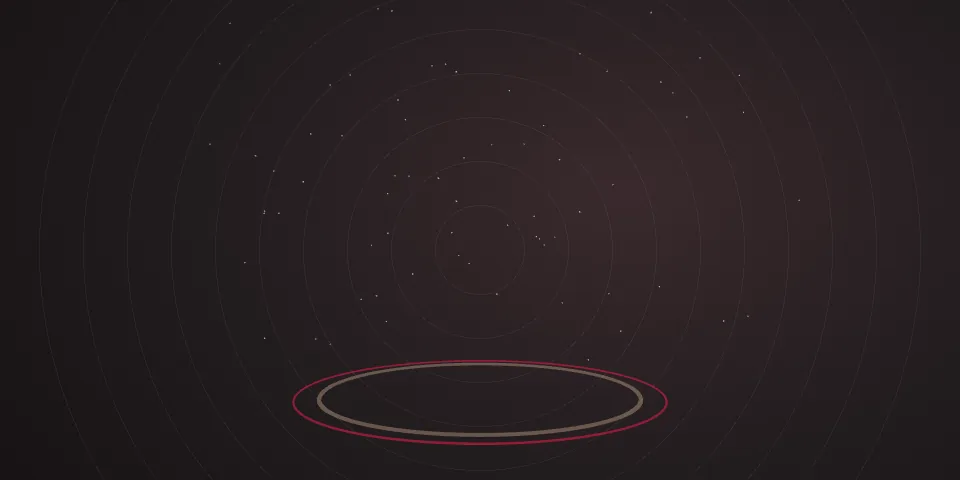
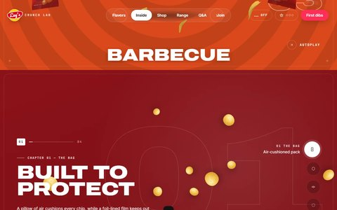
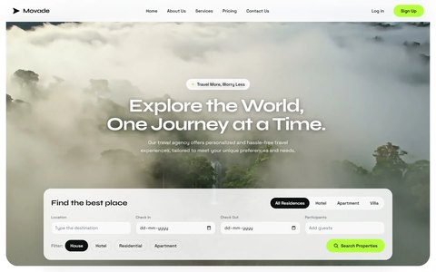
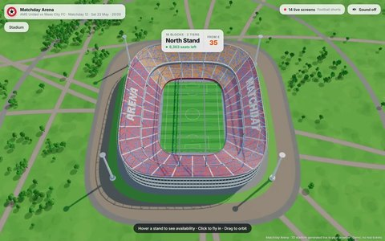

 

## 👋 About me

- 🤖 **AI Engineer · ML Engineer**: I build RAG apps, multi-agent AI systems and machine-learning models, then ship them in interfaces people enjoy.
- 🎓 B.Tech in Artificial Intelligence at **Saveetha University (SIMATS)**, Chennai.
- 🧪 Recently an **AI intern at Incode Vision**, building Gemini-powered chatbots with prompt engineering.
- 🎨 I also design and build immersive 3D web experiences, so the AI I build looks as good as it works.
- 🏏 Cricketer (batsman) since 2012: calm under pressure.
- 💡 *Build it. Break it. Ship it.*

## 🧠 What I build

<table>
<tr>
<td width="50%" valign="top">

### 📚 RAG & LLM apps
- **[DocuMind AI](https://github.com/Guru1315/Rag-Based-Project)**: chat with your own documents; every answer grounded and cited, and honest when the answer isn't there. *Next.js · pgvector · Gemini*
- **[Voice Support Agent](https://github.com/Guru1315/AI-Voice-Customer-Support)**: crawls any docs site and answers in text **and natural speech**, with sources. *OpenAI Agents SDK · Qdrant · TTS*
- **MindLab AI**: source-grounded research with clickable citations, study guides, quizzes and audio overviews.

</td>
<td width="50%" valign="top">

### 🤖 AI agents
- **Develop Team**: PM, architect, developer and tester agents turn a feature request into spec, code and tests; a supervisor loops fixes until it passes. *Flowise · n8n · Supabase*
- **[Fraud Investigator](https://github.com/Guru1315/AI-Fraud-Investigation)**: cross-checks public records, Street View and listings, and flags anomalies.
- **[AI Health Planner](https://github.com/Guru1315/AI-Health-Agent)**: dietitian + trainer agents write personal meal and workout plans. *Gemini · Agno*
- **[AI Personal Agent](https://github.com/Guru1315/AI-Personal-Agent)**: organises tasks and automates everyday work.

</td>
</tr>
</table>

### 📊 Machine learning: [11 algorithms, each on a real dataset](https://github.com/Guru1315/DAILY_PROJECTS_OF_ML-ALGORITHMS)

| Result | Project | Model |
|:--:|:--|:--|
| **0.97** ROC-AUC | Breast-cancer diagnosis | k-NN built from scratch |
| **0.92** ROC-AUC | Income > $50K | Gradient boosting / XGBoost |
| **97.8%** accuracy | Wine cultivars from 5 of 13 features | PCA + classifier |
| **94.9%** accuracy | Handwritten digits | Naive Bayes + PCA |
| **0.87** R² | Insurance cost | Linear regression |
| **0.85** ROC-AUC | Customer churn | Random forest, bagged by hand |

### ✨ Immersive web: 3D & motion

<table>
<tr>
<td align="center" width="25%"><a href="https://guru-perfume-ad-site.vercel.app"> <b>Écorce Parfums</b></a> 3D bottles orbit a fragrance wheel</td>
<td align="center" width="25%"><a href="https://guru-lays-site.vercel.app"> <b>Lay's Crunch Lab</b></a> a 3D chip bag turns as you scroll</td>
<td align="center" width="25%"><a href="https://movade-travel.vercel.app"> <b>Movade</b></a> a misty rainforest travel site</td>
<td align="center" width="25%"><a href="https://arena-match-booking.vercel.app"> <b>Matchday Arena</b></a> book 1 of 43,924 seats in 3D</td>
</tr>
</table>

## 🛠️ Skills

**AI & LLMs** 

**Machine learning** 

**Engineering** 

## 🗂️ More projects

| Project | What it does |
|:--|:--|
| [Image Caption Generator](https://github.com/Guru1315/AI_Image_Caption_Generator) | Upload an image, get a caption and detected objects (BLIP, DETR) |
| [Resume Screening System](https://github.com/Guru1315/AI_Resume_screening_system) | Ranks résumés against a job description with skill matching (BERT, TF-IDF) |
| [Saveetha Foodie Bot](https://github.com/Guru1315/AI-Chatbot_Saveetha_Foodie_bot) | Campus chatbot for food spots, prices and places |
| [Matchday Arena](https://github.com/Guru1315/Arena-Match-Booking-Site) | 3D stadium seat booking in the browser (Three.js, WebGL) |
| [My portfolio](https://github.com/Guru1315/Gurus-Portfolio) | The source of [gurucharan.me](https://www.gurucharan.me) |

## 📫 Let's talk

I'm open to **AI engineering and ML engineering** roles, internships and collaborations.
[Portfolio](https://www.gurucharan.me) · [Résumé](https://www.gurucharan.me/Guru-Charan-Resume.pdf) · [LinkedIn](https://www.linkedin.com/in/guru-charan-m-436b26435) · [gurumurugan291@gmail.com](mailto:gurumurugan291@gmail.com)

 
<i>The magic you're looking for is in the work you're avoiding.</i>

