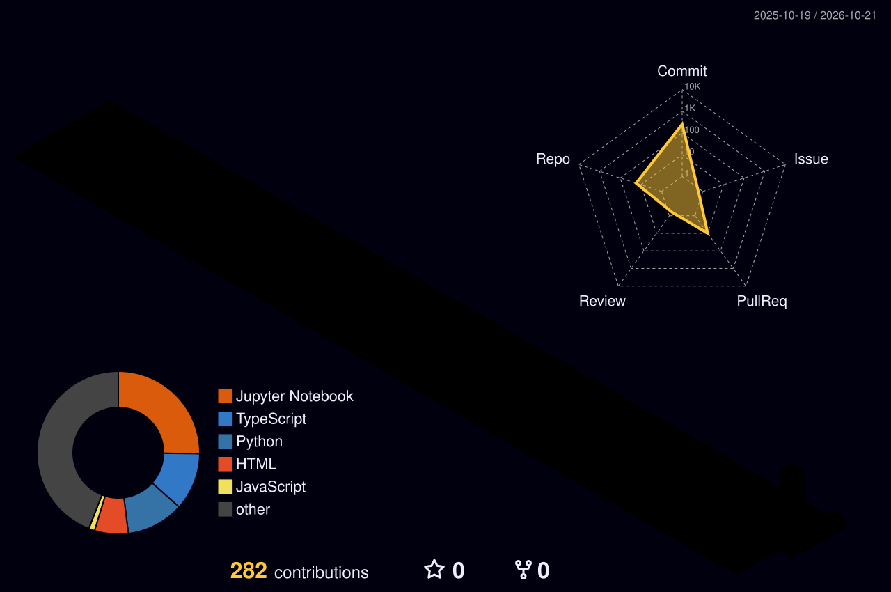

<!-- ============ HEADER ============ -->

 

---

<!-- ============ ABOUT ============ -->

<h2>About Me</h2>

- 🎓 B.Tech in **Computer Science & Engineering (AI)** at **Saveetha University**
- 🤖 I build **AI-powered applications** using NLP, deep learning and computer vision
- 📚 Strong foundation in **mathematics, statistics and database systems**
- 🚀 Currently working on **AI internship projects** with pre-trained models (BERT, BLIP, DETR)
- 🌱 Learning: **MLOps, Transformers, and building AI web apps**
- 💡 I enjoy turning real-world problems into working, explainable AI systems

---

<!-- ============ TECH STACK ============ -->

<h2>Tech Stack</h2>

  

---

<!-- ============ PROJECTS ============ -->

<h2>Featured Projects</h2>

| Project | What it does | Tech |
|---|---|---|
| 🖼️ **AI Image Caption Generator** | Upload an image and get an AI-written caption plus detected objects | BLIP, DETR, PyTorch, Transformers |
| 📄 **AI Resume Screening System** | Ranks resumes against a job description with explainable skill matching | BERT, TF-IDF, NLTK, scikit-learn |

---

<!-- ============ 3D CONTRIBUTIONS ============ -->

<h2>3D Contribution Graph</h2>

---

<!-- ============ STATS ============ -->

<h2>GitHub Stats</h2>

 

 

---

<!-- ============ CONTACT ============ -->

<h2>Let's Connect</h2>

  

*"Learning by building, one model at a time."*

