<div align="center">



<br/>

<a href="https://git.io/typing-svg">
  
</a>

<br/><br/>


</div>

<div align="center"></div>

<!-- ========== QUICK INTRO ========== -->
<div align="center">


### I turn ideas into **intelligent, working AI systems**
<sub>Voice AI  •  Health AI  •  Fraud Investigation  •  Personal Agents  •  Chatbots  •  NLP  •  Computer Vision</sub>

</div>

<div align="center"></div>

<div align="center">

<h2>Featured Projects</h2>
</div>

<table align="center">
<tr>
<td align="center" width="33%">

<h3>AI Voice Customer</h3>
<sub>Voice-driven AI assistant that understands customer queries and responds in natural language.</sub>
<br/><br/>
<a href="https://github.com/Guru1315/AI-Voice-Customer"></a>
</td>
<td align="center" width="33%">

<h3>AI Health</h3>
<sub>AI-powered health assistant that analyzes inputs and gives helpful, easy-to-understand guidance.</sub>
<br/><br/>
<a href="https://github.com/Guru1315/AI-Health"></a>
</td>
<td align="center" width="33%">

<h3>AI Fraud Investigator</h3>
<sub>Intelligent system that analyzes patterns and flags suspicious activity for investigation.</sub>
<br/><br/>
<a href="https://github.com/Guru1315/AI-Fraud-Investigator"></a>
</td>
</tr>
<tr>
<td align="center" width="33%">

<h3>AI Personal Agent</h3>
<sub>Personal AI agent that helps organize tasks, answer questions and automate everyday work.</sub>
<br/><br/>
<a href="https://github.com/Guru1315/AI-Personal-Agent"></a>
</td>
<td align="center" width="33%">

<h3>Foodie Bot</h3>
<sub>Chatbot I built for the <b>Saveetha campus</b> to help students find food spots, prices and locations.</sub>
<br/><br/>
<a href="https://github.com/Guru1315/Foodie-Bot"></a>
</td>
<td align="center" width="33%">

<h3>AI Image Caption Generator</h3>
<sub>Upload an image and get an AI-written caption plus detected objects using BLIP and DETR.</sub>
<br/><br/>
<a href="https://github.com/Guru1315/AI_Image_Caption_Generator"></a>
</td>
</tr>
<tr>
<td align="center" colspan="3">

<h3>AI Resume Screening System</h3>
<sub>Ranks multiple resumes against a job description using BERT, TF-IDF and explainable skill matching.</sub>
<br/><br/>
<a href="https://github.com/Guru1315/AI-Resume-Screening-System"></a>
</td>
</tr>
</table>

<div align="center"></div>

<div align="center">

<h2>Tech Arsenal</h2>
</div>

<div align="center">


<br/><br/>


</div>

<div align="center"></div>

<div align="center">

<h2>What I Work On</h2>
</div>

<table align="center">
<tr>
<td align="center" width="25%"><br/><b>NLP</b><br/><sub>Text analysis, similarity, chatbots</sub></td>
<td align="center" width="25%"><br/><b>Computer Vision</b><br/><sub>Captioning, object detection</sub></td>
<td align="center" width="25%"><br/><b>Voice AI</b><br/><sub>Speech-driven assistants</sub></td>
<td align="center" width="25%"><br/><b>AI Safety &amp; Fraud</b><br/><sub>Pattern and anomaly analysis</sub></td>
</tr>
</table>

<div align="center"></div>

<div align="center">

<h2>Achievements</h2>
</div>

<div align="center">

</div>

<div align="center"></div>

<div align="center">

<h2>3D Contribution Graph</h2>
</div>

<div align="center">

</div>

<div align="center"></div>

<div align="center">

<h2>GitHub Stats</h2>
</div>

<div align="center">


<br/>


<br/>


</div>

<div align="center"></div>

<div align="center">

<h2>Let's Connect</h2>
</div>

<div align="center">

<a href="https://www.linkedin.com/in/YOUR-LINKEDIN-ID"></a>
<a href="mailto:YOUR-EMAIL@example.com"></a>
<a href="https://github.com/Guru1315"></a>

</div>

<div align="center"></div>

<!-- ========== ABOUT ME (END) ========== -->
<div align="center">

<h2>About Me</h2>
</div>

<div align="center">
<sub><i>The developer behind the projects</i></sub>
</div>

<br/>

<table align="center">
<tr>
<td width="50%" valign="top">

```js
const guru = {
  name: "Guru",
  role: "AI Developer & CSE (AI) Student",
  university: "Saveetha University",
  focus: ["NLP", "Computer Vision",
          "Voice AI", "AI Agents"],
  built: ["AI Voice Customer", "AI Health",
          "AI Fraud Investigator",
          "AI Personal Agent",
          "Foodie Bot (Saveetha campus)",
          "Image Caption Generator",
          "Resume Screening System"],
  strongIn: ["Maths", "Statistics",
             "Databases", "Python"],
  currentlyLearning: ["MLOps", "LLM Apps",
                      "Transformers"],
  lookingFor: "AI/ML opportunities & collaborations",
};
```

</td>
<td width="50%" valign="top" align="center">


**🎓 Education**
B.Tech CSE (AI), Saveetha University

**⚡ What drives me**
Building AI that solves real problems, from a campus Foodie Bot to health and fraud-detection assistants.

**🧪 How I work**
Pre-trained models, clean pipelines, and explainable results I can demo.

**🎯 Goal**
Grow into an AI engineer who ships useful, trustworthy AI products.

</td>
</tr>
</table>

<div align="center">


<i>"I don't just study AI. I build it, break it, and ship it."</i>

<br/><br/>


</div>
